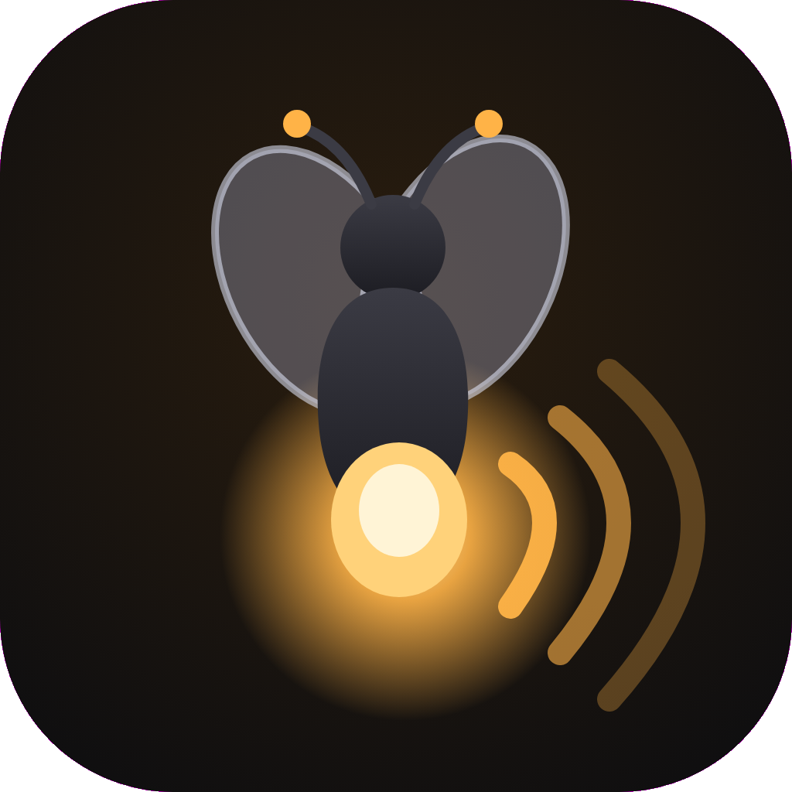
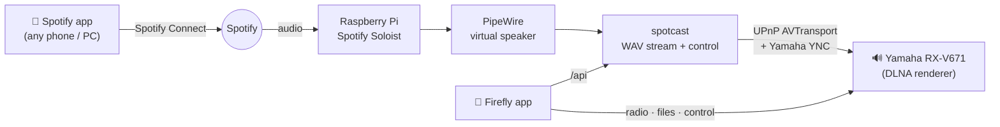

<p align="center">
  
</p>

<h1 align="center">Firefly</h1>

<p align="center">
  <b>Give a 2011 Yamaha receiver Spotify Connect, internet radio and phone playback, with no dongles, no adapters and no PC.</b>
</p>

<p align="center">
  <a href="../../releases/latest"></a>
  <a href="../../actions/workflows/build.yml"></a>
  
  
</p>

---

## Why this exists

The **Yamaha RX-V671** (2011) is a great amplifier with a dated network stack: no Wi-Fi, no Bluetooth,
no AirPlay and no Spotify Connect. What it *does* have is an Ethernet port and a DLNA/UPnP media
renderer. Firefly uses only that renderer to bring the receiver up to date:

| You want to… | Firefly gives you… |
|---|---|
| Play Spotify from any phone, with Spotify's own app | **Spotify Connect** device "Living Room (RX-V671)" served by a Raspberry Pi bridge |
| Let everyone in the house use their **own** Spotify account | One player per account; the newest player takes over automatically, with no sign-in or sign-out |
| Listen to internet radio | **Firefly app**: search 40,000+ stations and send them to the receiver |
| Play music files from your phone or PC | **Firefly app**: queue local MP3/FLAC/WAV/AAC files |
| Control the receiver itself | Power, input, real-dB volume, mute, sleep timer, from the app |

Nothing is bought, plugged into the receiver's inputs, or left running on a computer.

## How it works



* **[Spotify Soloist](https://developer.spotify.com/documentation/soloist)**, Spotify's official headless
  Connect player, runs on the Pi and plays into a PipeWire null sink.
  (librespot is not used: Spotify refuses audio keys to it for newer accounts; see
  [librespot#1649](https://github.com/librespot-org/librespot/issues/1649).)
* **spotcast** (`pi/spotcast.py`) captures that sink and serves it as an uncompressed WAV stream.
  It tells the receiver to switch to its `PC` (DLNA) input and play the stream over UPnP, and it
  powers the receiver on through Yamaha's YNC control API when needed.
* The **Firefly app** (Flutter) talks UPnP directly to the receiver for radio and files, and uses
  spotcast's small JSON API for Spotify status, receiver control and household management.

## Features

**Spotify (via the Pi bridge)**
- Shows up in Spotify as **Living Room (RX-V671)**: pick it from the device list like any speaker
- **Multi-account**: each household account gets its own player; the newest player wins and the rest pause
- **"Add me" appears only when needed**: a new phone opening Spotify on the Wi-Fi sees *Living Room - Add me*
  for 10 minutes; registered devices don't
- Automatic **input switch and power-on**, and **hand back** to the previous input (or standby) after 20 idle minutes
- **Low latency**: ≈ 0.3 s from the Pi to the speakers (see [Latency](#latency))
- **Self-healing**: watchdog, stall detection with adaptive buffering, auto-restart, and a daily Soloist auto-update
- Optional **alerts** (ntfy or Discord): receiver offline, update failures, repeated dropouts, Pi reboot

**Firefly app (Android · iOS · Windows)**
- **Home**: receiver power, input chips, volume in dB with a safety ceiling, mute, Spotify now playing,
  sleep timer, hand back, latency and health
- **Radio**: search the [Radio Browser](https://www.radio-browser.info/) directory, browse genres, keep favourites
- **Library**: multi-file queue with auto-advance, and recently played
- **Settings**: people and devices, receiver discovery (SSDP plus a unicast sweep, so it works on iOS without
  multicast entitlements), bridge address, update status
- Mini player and full-screen Now Playing on every screen

### Modern-receiver features (Receiver tab)

The Pi makes the 2011 RX-V671 behave like a current streaming receiver, with no extra hardware:

- **AirPlay 2** (iPhone, iPad, Mac, Apple Music), built from source by `pi/build-airplay2.sh`.
  The AirPlay volume slider moves the receiver's real volume.
- **Cast (DLNA)**: appears as *Living Room (Pi cast)* in apps that cast to DLNA renderers.
- **Bluetooth**: pairs as *Living Room Speaker*, no PIN; "Pair a phone" opens a 3-minute window.
- **Internet radio played by the Pi**, so it works with everything below.
- **Last source wins**: the newest source to start is heard; the others are muted and paused.
- **Auto on / auto standby**: any source powers the receiver on and switches it to PC; after
  20 minutes of silence it goes back to what it was doing (or standby).
- **Sound**: sound program (DSP), Straight, Pure Direct, Compressed Music Enhancer, CINEMA DSP
  3D, Dialogue Lift, night mode (Adaptive DRC), bass and treble, the receiver's own scenes 1-4.
- **The receiver's own sources**: FM/AM tuner (presets, scan, direct tuning), USB stick and
  media-server browsing with play controls, and renaming inputs (shown on the front display).
- **Scenes**: one tap sets input, sound, volume and Zone 2. Each scene is also an Alexa device
  (`alexa_local.py`) for voice and routines, along with *Night Mode* and *Zone 2*.
- **Zone 2**: power, input and volume for a second room.
- **Loudness levelling and room EQ**: LADSPA filters in PipeWire in front of the stream. *Measure
  my room* plays a tone per band through the receiver and measures it with the phone's
  microphone, then applies gentle corrections (Android, iOS).
- **Schedules**: wake up to Spotify, an FM/AM preset or a radio stream with a slow volume fade
  (1-60 min), fade-out sleep (ends in standby at the old volume), timed scenes, timed off. A fade
  stops as soon as anyone moves the volume by hand.
- **Automations**: sleep timer, quiet hours (a volume cap that also catches the remote), sound
  per source (e.g. Straight + Enhancer for Spotify, Standard for HDMI1), and a receiver health
  graph (response time per hour, the early sign of a network freeze).
- **Android extras**: lower the volume during phone calls, a *Receiver* quick-settings tile and a
  home-screen remote widget. All work with the app closed.
- **Alexa** (`alexa_local.py`, local Hue emulation): Receiver, TV Mode, Music, Night Mode, Zone 2,
  FM Radio, USB, Dialogue Lift, Sleep Timer ("set Sleep Timer to 50%" = 45 min), one device per
  radio preset, and one per scene.
- **History**: listening time per source per day, recent tracks and problems, also on the
  status page.

Pi API for all of the above: `/api/x/{status,sound,zone2,inputs,input_names,sources,bt,radio,`
`dsp,roomeq/start,roomeq/apply,scenes,schedules,history,tuner,usb,server,sleep,fade,quiet,`
`source_sound,health,quick,duck}`.

The Pi also keeps a nightly settings snapshot (`/var/backups/spotcast`, 14 days, the Soloist key
excluded); restore with `tar -xzpf <file> -C /`.

## Requirements

| | |
|---|---|
| Receiver | Yamaha RX-V671 (other Yamaha RX-V/RX-A models with DLNA + YNC very likely work) wired to your router |
| Bridge | Raspberry Pi 3/4/5 (64-bit) on the same LAN; Ethernet recommended |
| Spotify | **Premium** account to create the free Soloist API key; listeners' accounts likely also need Premium |
| Phones | Android 8+, iOS 15+ (sideloaded), or Windows 10/11 |

## Setup

### 1. Receiver
1. Plug the receiver's **NETWORK** port into your router.
2. On the receiver: *Setup → Network → Network Standby → On* (lets the bridge wake it).
3. Optional but recommended: give it a DHCP reservation in your router.

### 2. Raspberry Pi bridge
1. Create a Soloist API key at <https://developer.spotify.com/dashboard/soloist> (Premium account).
2. On the Pi, one command (it asks for the key; the receiver is found automatically):
   ```sh
   curl -fsSL https://raw.githubusercontent.com/grimmmyy/Firefly/main/pi/get.sh | sudo sh
   ```
   Or from a clone: `cd Firefly/pi && sudo ./install.sh`.
   Optional env: `RECEIVER_IP=…` (skip discovery), `SPEAKER_NAME="Kitchen (RX-V671)"`,
   `NTFY_TOPIC=my-private-topic`, `DISCORD_WEBHOOK=https://…`,
   `HEARTBEAT_URL=https://hc-ping.com/…` (alerts you when the Pi itself goes offline).
3. In Spotify on the same Wi-Fi, pick **Living Room - Add me** once. From then on it appears as
   **Living Room (RX-V671)** on your account.
4. Status page: `http://<pi-ip>:8090`: health checks, recent problems and the app pairing QR code.
   JSON: `/api/status`, `/api/diagnose`.

The bridge finds the receiver again by itself if its address changes, and re-points the stream
when the Pi switches between Ethernet and Wi-Fi. With Tailscale on the Pi and your phone, a paired
app works away from home (off the LAN the API requires the pairing token).

The API key is stored only in `/etc/spotcast/soloist.env` (mode 600) on the Pi.

### 3. Firefly app
Download from the [latest release](../../releases/latest):

| Platform | File | Install |
|---|---|---|
| Windows | `Firefly-vX-windows-setup.exe` | Run the installer (Start menu shortcut and uninstaller included). A portable `…-windows-portable.zip` is also attached. |
| Android | `Firefly-vX-android.apk` | Open it and allow "install unknown apps" |
| iOS | `Firefly-vX-ios.ipa` | Sideload with [AltStore](https://altstore.io) or [Sideloadly](https://sideloadly.io) (free Apple ID: re-sign every 7 days) |

Every release ships all three, and CI refuses to publish a release unless the EXE, IPA and APK all built.

**Updates without hunting for files:** every successful build also replaces the rolling
[`nightly`](../../releases/tag/nightly) pre-release, which carries an AltStore source. Add
`https://github.com/grimmmyy/Firefly/releases/download/nightly/altstore.json` in AltStore
(Sources → +) once, and new builds appear under **Updates**. The Pi mirrors each nightly to its
download page (`http://<pi-ip>:8091`, `pi/firefly-dl-sync.sh`).
Each release also includes the Raspberry Pi bridge (`spotcast-pi-bridge-vX.tar.gz`) and `SHA256SUMS.txt`.

On first launch Firefly runs **Set up & check** (also in Settings): it finds the bridge and receiver,
runs the bridge's health check, plays a test tone, and can scan the bridge's pairing code.

On first launch, allow **Local Network** access (iOS) and the Windows Firewall prompt (**Private** networks),
because the receiver pulls audio from the app.

## Latency

Measured on an RX-V671 over Ethernet:

| Stage | Time |
|---|---|
| Play command → receiver reports `PLAYING` | ~40 ms |
| Audio queued inside the Pi | 5–15 ms |
| Receiver DLNA buffer, **trimmed** | ~0.30–0.38 s (untrimmed it settles at a random 0.25–0.8 s per connection) |

spotcast measures the receiver's buffer at each `RelTime` tick and withholds *silent* audio to trim it to the
receiver's floor (~0.3 s). The output format doesn't change the buffer (MP3, WAV 44.1–96 kHz and 16/24-bit
were tested), and the RX-V671 rejects `audio/L16`.

## Receiver quirks (RX-V671)

- `AVTransport.Play` returns **501** unless the input is **`PC`**; switch with YNC first.
- `SetAVTransportURI` with DIDL-Lite metadata returns **500**; send empty metadata.
- Accepts streaming WAV with an open-ended header; rejects L16.
- YNC control: `POST http://<receiver>/YamahaRemoteControl/ctrl`.
- **Network control freezes** (answers ping, HTTP hangs, needs a wall unplug). One cause is
  proven: GENA subscriptions left behind by restarts (events are now off by default). The prime
  suspect for the rest is **ARP flux** when the Pi is on the LAN twice (Ethernet + Wi-Fi) with
  Linux's default ARP settings; the installer sets `arp_ignore=1` / `arp_announce=2`. Ruled out by
  testing: SSDP floods (59,000 announcements) and connection churn (5,000 connections).
- The media-server client is the **`PC`** input (YNC tag `PC`), the same input the bridge streams to.
- FM tunes in 200 kHz steps from 87.5 MHz; `Tuner` frequency values are MHz × 100.

## Building from source

```sh
flutter create . --platforms=android,ios,windows --org com.firefly --project-name firefly
flutter pub get
dart run flutter_launcher_icons -f icons-mobile.yaml   # or icons-windows.yaml
flutter build apk --release        # Android
flutter build ios --release --no-codesign
flutter build windows --release
```

CI builds every push, and `pi-tests.yml` runs the Pi bridge's offline tests
(`python -m unittest discover -s pi/tests`) whenever `pi/` changes. Pushing a `v*` tag builds all platforms and publishes a GitHub Release with the
Windows installer (`.exe`), iOS `.ipa`, Android `.apk`, a portable Windows zip, the Pi bridge tarball
and checksums. If any platform fails, no release is published.

## Limitations

- Spotify playback needs the Pi; iOS can't capture other apps' audio, so the phone can't be the bridge.
- Soloist builds expire 90 days after release; the Pi updates itself daily.
- Soloist only appears to the account it is paired with; Firefly works around this with one player per
  account and a self-managing "Add me" slot.

## Legal

Firefly uses Spotify's official Soloist binary, downloaded on your Pi from Spotify's CDN; nothing Spotify
is redistributed here. By using it you accept Spotify's terms. "Spotify" and "Yamaha" are trademarks of
their owners; this project is not affiliated with either.

## License

[MIT](LICENSE)
